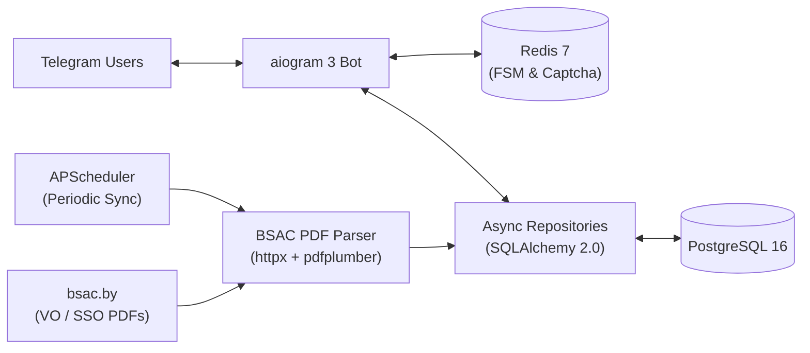

<div align="center">

# 🎓 BSAC Schedule Bot `v2.0`

**Асинхронный Telegram-бот расписания Белорусской государственной академии связи (БГАС)**

[](https://www.python.org/)
[](https://docs.aiogram.dev/)
[](https://www.postgresql.org/)
[](https://redis.io/)
[](https://www.docker.com/)
[](https://docs.astral.sh/ruff/)

</div>

---

## ✨ Возможности

- **Быстрый доступ к расписанию**: сохранение выбранной группы в БД и мгновенный просмотр пар на **Сегодня**, **Завтра** и **Неделю** прямо со стартового экрана или через команды.
- **Автоматический парсинг PDF с `bsac.by`**: фоновый планировщик (`APScheduler`) регулярно скачивает актуальные PDF для **ВО и ССО (дневное и заочное отделения)**, автоматически извлекает список групп и парсит таблицы через `pdfplumber` в PostgreSQL.
- **4-недельный учебный цикл**: точный расчёт текущей учебной недели (1–4) с автоматическим переносом воскресенья на понедельник следующей недели.
- **Репорты об ошибках с капчей**: проверка через фруктовую капчу, привязанную к Redis FSM конкретного пользователя (без гонок состояний), и отправка отчётов в админ-чат.
- **Администрирование и защита**: middleware проверки банов, команды `/sync` и `/sendlogs` для админов, ротация логов.

---

## 🏗 Архитектура



### Структура проекта

```text
newSBTAio/
├── alembic/                 # Миграции БД (Alembic async)
├── pictures/                # Медиа-ресурсы для шагов меню (1.png – 8.png)
├── src/sbt_bot/
│   ├── bot/
│   │   ├── handlers/        # Роутеры: start, menu, report
│   │   ├── keyboards/       # Inline-клавиатуры меню и капчи
│   │   ├── callbacks.py     # Типизированные CallbackData
│   │   ├── middlewares.py   # DI сессии БД и проверка банов
│   │   └── states.py        # Состояния FSM
│   ├── db/
│   │   ├── base.py          # AsyncEngine & session_factory
│   │   ├── models.py        # User, StudyGroup, ScheduleEntry, Report
│   │   └── repositories.py  # UserRepository, ScheduleRepository, ReportRepository
│   ├── parser/
│   │   ├── base.py          # Интерфейс ScheduleSource
│   │   ├── bsac_pdf.py      # Парсер PDF-расписаний с bsac.by
│   │   └── service.py       # ScheduleSyncService
│   ├── utils/
│   │   ├── captcha.py       # Генератор фруктовой капчи
│   │   ├── formatting.py    # HTML-форматирование расписания на день/неделю
│   │   └── week.py          # Расчёт номера учебной недели (1–4)
│   ├── config.py            # Настройки через pydantic-settings
│   ├── logging_setup.py     # Консольное и файловое логирование с ротацией
│   └── main.py              # Точка входа и запуск polling + scheduler
├── tests/                   # Unit- и интеграционные тесты (pytest)
├── Dockerfile
├── docker-compose.yml
└── pyproject.toml
```

---

## 🤖 Команды бота

| Команда | Доступ | Описание |
| :--- | :--- | :--- |
| `/start` | Все | Главное меню, выбор ступени/курса/группы или быстрый просмотр |
| `/today` | Все | Расписание на сегодня для сохранённой группы |
| `/tomorrow` | Все | Расписание на завтра для сохранённой группы |
| `/week` | Все | Полное расписание на текущую неделю |
| `/help` | Все | Справка по доступным командам |
| `/sync` | Админ | Принудительный запуск парсинга расписания с `bsac.by` |
| `/sendlogs` | Админ | Отправка файла логов в чат |

---

## 🚀 Быстрый старт (Docker Compose)

1. **Клонируйте репозиторий и создайте `.env`**:
   ```bash
   cp .env.example .env
   ```
   > [!IMPORTANT]
   > Укажите актуальный `BOT_TOKEN` из `@BotFather`, `ADMIN_IDS` и `REPORT_CHAT_ID`. Старый токен из истории ветки `master` необходимо перевыпустить.

2. **Запустите весь стек** (`bot` + `postgres` + `redis`):
   ```bash
   docker compose up -d --build
   ```
   Контейнер автоматически применит миграции (`alembic upgrade head`) и запустит бота.

---

## ⚙️ Переменные окружения

| Переменная | По умолчанию | Описание |
| :--- | :--- | :--- |
| `BOT_TOKEN` | — | Токен Telegram-бота (обязательно) |
| `ADMIN_IDS` | `[]` | JSON-список Telegram ID администраторов |
| `REPORT_CHAT_ID` | `None` | ID чата/канала для отчётов об ошибках |
| `DATABASE_URL` | `postgresql+asyncpg://...` | Строка подключения к PostgreSQL |
| `REDIS_URL` | `redis://localhost:6379/0` | Строка подключения к Redis |
| `BSAC_VO_URL` | `http://bsac.by/tasks/vo/do` | Страница PDF-расписания ВО (дневное) |
| `BSAC_VO_ZO_URL` | `http://bsac.by/tasks/vo/zo` | Страница PDF-расписания ВО (заочное) |
| `BSAC_SSO_URL` | `http://bsac.by/tasks/sso/do` | Страница PDF-расписания ССО (дневное) |
| `BSAC_SSO_ZO_URL` | `http://bsac.by/tasks/sso/zo` | Страница PDF-расписания ССО (заочное) |
| `PARSE_INTERVAL_MINUTES` | `180` | Интервал автообновления расписания (мин) |
| `TIMEZONE` | `Europe/Minsk` | Часовой пояс для расчёта недели и дней |

---

## 🧪 Локальная разработка и тесты

```bash
python -m venv .venv
# Windows: .venv\Scripts\activate | Linux/macOS: source .venv/bin/activate
pip install -e ".[dev]"

pytest -v
ruff check src tests
```
